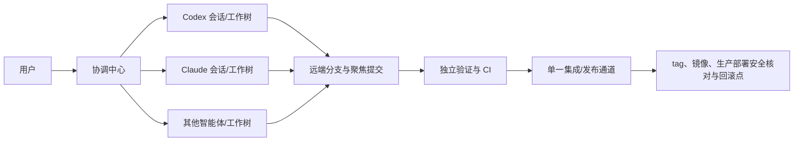

# KPanel 跨智能体协作运行手册

本手册说明 Codex、Claude 及其他智能体如何在同一 KPanel 项目中并行工作。强制规则以
[`project-management.md`](project-management.md) 为准。

## 协作架构



智能体之间不需要读取彼此的私有对话；它们通过 SSH 远端分支、聚焦提交和 CI 交换可验证状态。

## 工具入口

| 工具 | 首个入口 | 专属能力 | 不可作为全局真源的内容 |
| --- | --- | --- | --- |
| Codex | `AGENTS.md` | Codex 任务复用、等待、`.codex-workflows/` | Codex 任务标题、会话 ID、未提交上下文 |
| Claude | `CLAUDE.md` | Claude/Claude Code 会话与本地工具 | Claude 会话历史、Todo、未提交上下文 |
| 其他智能体 | `PROJECT_RULES.md` + 本手册 | 工具自身能力 | 工具私有记忆和聊天记录 |

所有工具共同读取 `PROJECT_RULES.md` 和 `docs/project-management.md`，共同执行仓库的 Make、测试、
CI 和发布入口。规范分层、Definition of Ready/Done、任务契约和交付包只在
`docs/project-management.md` 定义，本手册不维护平行版本。
Windows 没有 Make 时使用 `node scripts/run-repo-bash.mjs <script>` 调用同一 Bash 门禁；该适配器从
当前 Git for Windows 安装定位解释器，避免 PATH 中的 WSL `bash.exe` 误读 Windows linked worktree。

## 标准协作流程

执行顺序和退出条件统一引用 [`project-management.md` 1.1](project-management.md#11-最短执行路径)：
准备 → 实施 → 交付 → 集成与收尾。本手册只补跨工具交接，不重复展开门禁和审批清单。

- 准备使用第 6 节唯一任务契约；启动入口已核实的 Git/工具结果直接引用，身份变化才更新。
  工作树角色沿用 `scripts/check-collaboration-state.mjs`，交付使用 `--require-candidate`。
- 实施使用第 7 节唯一分级入口；适用评审、acceptance 预览与独立性按原规则完成。
- 交付以 clean 非空候选、标准交付包和原件重建上下文，不接收共享脏工作树。
  未授权推送时独立复核可读取本地精确提交，但不得宣称远端交付或已集成。
- 集成按第 9/10 节；永久治理必须有同 SHA 候选 Linux CI 和主线 CI，候选分支保留到主线 CI 成功。
  接手者一次核对交付包并自行闭环，归档按第 10.2 节；不另设监工，不召回已交付 writer。

## 路径声明与冲突判断

开始任务时声明预计修改的文件或目录：

```text
允许：internal/monitoring/**, web/src/components/monitoring/**
禁止：VERSION, CHANGELOG.md, .github/workflows/**
契约依赖：internal/contract/monitoring.go
```

- 两个任务路径完全分离且无共享契约，可以并行。
- 共享 API、Schema、版本文件、依赖锁文件或同一设计文档时，必须定义先后依赖或由一个任务拥有共享文件。
- `VERSION`、`CHANGELOG.md`、Release workflow 和候选分支在发布冻结后只归发布任务所有。
- 实际需要越出声明范围时，先由协调中心重新确认任务契约和冲突，不得直接扩大范围。

## 上下文与证据效率

执行预检、失败分类与外层重试边界统一遵循 `docs/project-management.md` 6.2.2；复核者读取原始
证据并独立判断，不因接手而重复相同门禁。普通执行细节由当前负责人在既有权限内闭环；只有影响
目标、风险或权限的选择才回到协调中心，不能把反复询问或新增监工任务当作质量保证。

复杂任务的路径、工具和字段资格统一按 `docs/project-management.md` 6.2.1 使用
`scripts/task-preflight.mjs ready|handoff`；先将必需输入缺项成组处置，再进入长验证。
复用已交付候选和精确原始证据；发布接管不召回旧 writer、不增加监工。源码发布检查按该文档第 10 节
统一并行入口执行，失败、取消或候选变化必须重新形成有效结果。

- 新任务先通过 `AGENTS.md`/`CLAUDE.md` 和当前产品复核定位业务域，再按 L0-L3 加载相关规范章节；
  只有 L3 或规范架构变更才机械需要完整规范包，普通小改不把长文全量转发给每个会话。
- 协调中心只把目标、任务契约、相关设计/代码、精确基线和已知风险交给执行者，不转发无关长对话。
- 执行者先使用 `rg` 定位受影响实现和测试；已有精确提交证据足够时不重复全仓扫描或相同环境全量测试。
- 验证者从提交差异和失败边界出发，补实现者未覆盖的证据；不以换一个模型重复同一命令冒充独立复核。
- 候选接管和发布期间的修复、验收、消息与结束条件统一按 [`project-management.md` 10.1](project-management.md#101-发布接管后的责任) 执行，不召回已交付任务。
- 证据只对精确提交、环境和参数有效。`HEAD`、锁文件、工作流、镜像基础层或实机环境变化时，相关
  结果失效并从受影响层重跑。
- 长期状态只进入 Git、CI、Release、验收记录和必要设计文档；临时推理、会话 ID、模型偏好和工具
  内 Todo 不写入仓库。
- 长时间浏览器 E2E/稳定性测试必须通过 `background-browser-validation` 形成后台 job ID、唯一证据目录、
  硬超时和终态；启动会话不需要前台等待，当前责任任务读取同一状态，不重复启动或凭日志增长判成功。
  发布期间由发布任务负责，不要求另设监控会话或协调中心定时询问。
- 可见功能使用 `local-feature-preview` 交付统一回环预览卡；不同会话使用动态端口和独立证据目录，mock、
  本地集成与隔离真机结论不得混写，交接时同时交接 manifest 和停止责任。
- 任何远程操作前使用 `environment-policy.json` 检查用途。`prod-108`/`108` 禁用全部 KPanel 操作；
  测试、只读检查、备份、部署、升级、回滚演练、健康采样、日志读取和清理均不得连接。
- 发布在 `github-hosted` 的 GitHub Actions 内执行完整 L3、Release、Docker Hub 与公开浏览器验收；不委派到自有服务器或 WSL。原 bundle 仅作历史证据，接手使用 run ID/attempt 与 artifact。

## 跨智能体移交模板

```text
任务 scope：<stable-slug>
移交：Codex -> Claude（或 Claude -> Codex）
当前状态：待复核 / 阻塞
基线：<commit>
分支：<branch>
最新提交：<commit>
工作树：clean / dirty（dirty 时列出全部文件）
已完成：
验证命令与结果：
失败或未验证：
允许继续修改：
禁止修改：
建议下一步：
回滚点：
权限：是否允许提交/SSH 推送/更新 main/发布
```

接手者必须先独立执行 `git fetch`、`git status`、`git log` 和差异检查。正式交付前，没有提交的复杂修改
由原智能体完成检查点，不通过复制文件或共享脏工作树交接。发布已接管的明确遗留项按项目管理 §10.1
由发布任务自行处理，不重新召回原智能体。

## 能力路由与独立复核

- 按任务所需能力、当前上下文、工具可用性和路径冲突选择智能体，不为模型品牌固定永久角色。
- 协调、分析、开发、验证、集成和发布均可由任一经授权智能体承担，但同一时刻角色和路径所有权唯一。
- 安全盲审（`PROJECT_RULES.md` 5.4）框架中立：任何能启动无上下文子代理或新会话的智能体经
  `.codex-workflows/security-boundary-audit.workflow.yaml` 同一入口执行，复核者不限提供商与模型。
  复核者输出是线索，实现者逐条核实后才形成 confirmed；状态只记在 `Security-Review:` trailer，不维护账本。
  CF 历史产物保留在 `.governance/security-audit/run-*`，只读。
- OCR 行级评审辅助（`PROJECT_RULES.md` 5.5）同样框架中立：任何智能体经
  `.codex-workflows/ocr-line-review.workflow.yaml` 与 `scripts/ocr-delegate.mjs` 同一入口执行，OCR 只做
  圈选和规则解析，评审由执行智能体完成；按 `PROJECT_RULES.md` 5.5 先保存自由臂结果，
  再执行约束臂，两者均需完成；它不构成独立复核。
- L2 优先由不同任务独立复核；L3 的主要实现者与最终验证/发布者必须分离，接手发布任务可承担最终验证，
  不要求第三个常驻复核任务。L2/L3 独立复核与 `PROJECT_RULES.md` 5.3 规范复核默认由与实现者不同的模型
  提供商执行，以减少同源模型的共享盲区；另一提供商不可用（未安装、无非交互入口、配额耗尽等）时，
  才使用与主要实现分离的干净会话。每次独立复核都要留下
  `Independent-Review: reviewer=<提供商> author=<提供商> result=<PASS|PASS WITH FOLLOW-UP|FAIL>` trailer，
  提供商取 `claude`、`codex`、`gemini`、`qwen`、`deepseek`、`copilot` 之一。同一提供商时追加
  `fallback=<取值>`，取值固定为 `provider-unavailable`（其他提供商没有可用入口：未安装、无非交互入口、
  无凭据或配额耗尽）或 `provider-failed`（已调用其他提供商，但被拒绝、超时或中途中止），具体情况另写
  `detail=<说明>`，不改变取值；缺少 `fallback` 或取值不在其中的同提供商复核视为未说明原因，健康报告分别计为
  `same_provider_without_fallback` 和 `fallback_unrecognized`，候选检查以 `independent_review=nonconforming`
  提醒。只读复核自身不产生提交时，由候选负责人在包含复核结论或其修复的下一个提交上补写；
  L3 发布接管后由发布任务在其集成或验收提交上写，不因此另设复核任务。治理提案同时填写模板的
  "复核提供商 / 实现提供商"。已推送的 trailer 不改写，格式错误只计数和提醒，不阻断。
- 评审价值来自不同假设、失败边界和证据，不来自模型名称；换提供商只降低共享盲区，不替代证据。
  最终仍以精确差异、测试、实机和 CI 判断。

## 失败处理

- GitHub 插件、Issue、PR、API 或 `gh` 不可访问：不影响 Git 开发；确认 SSH remote 和任务所有权后继续。
- SSH 认证失败：停止远端交付，保留本地提交，修复仓库专用 SSH 凭据后再推送。
- 负责人失联：协调中心确认远端分支、最新提交和工作树后再移交。
- 两个智能体修改同一文件：停止其中一方，分别保存聚焦提交，由集成任务决定顺序和冲突处理。
- 智能体声称完成但无非空候选提交或证据：状态保持开发中，不进入集成；只读/无需修改关闭除外。
- dirty 本地差异只能标记执行中、取消或阻塞；不能作为完成交付，也不能通过复制文件交接。
- 发布期间出现新功能：进入下一版本任务分支，不修改冻结候选。
- 管理工作树检查失败：保留 `status`、分支和 ahead/behind 证据，只隔离该树；不 reset、stash、clean
  或覆盖文件，后续写任务从精确远端基线建立新 worktree。
